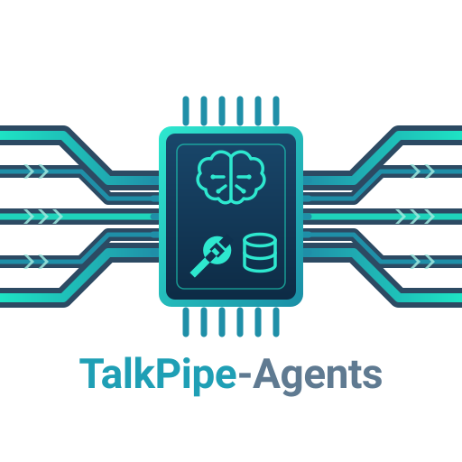

<center>

<h1> Putting Agents in their Place</h1>

Agentic segments for [talkpipe](https://github.com/sandialabs/talkpipe),
built on [Strands Agents](https://strandsagents.com), packaged as a
talkpipe plugin.
</center>

## Why

This library exists to support workflows that need agentic tool use at specific, bounded steps rather than across the whole system. Today's agents can autonomously select tools, parameterize actions, and execute them with remarkable speed and flexibility. That power is transformative, but it is also inherently probabilistic: when a model is given broad access to real systems over an extended period of time, mistakes can compound. Managing that tension requires intentional engineering design. The solutions to some use cases need agents at the foundation of a broad set of tooling to let them compose workflows on the fly. For the solutions to other use cases, most of the workflow remains deterministic, and agentic tool use fits into that flow in a narrow, well-defined space. This library is designed to help engineers address that second family of use cases. It keeps the surrounding pipeline deterministic, explicit, and reviewable while giving an agent room to act inside a single, bounded step. The result is a system that preserves control where it matters and grants autonomy only where it creates value. In other words, capability is not left unbounded; it is given a clear home, and the right tool is used for the right job.

talkpipe-agents is a [Talkpipe](https://github.com/sandialabs/talkpipe) plugin built on [Strands Agents](https://strandsagents.com/), making it straightforward to create and incorporate agents and agentic tooling into talkpipe workflows.

## Hello, world

Needs Python 3.11 or newer, and a model that can call tools. The
quickest no-key setup is a local [Ollama](https://ollama.com) with a
tool-calling model pulled (`ollama pull llama3.2`), but Ollama is only
one of the supported providers. The same workflow works with other
providers too; see [Model providers](docs/model-providers.md).

```bash
pip install talkpipe-agents
```

(To install from source, use a git clone, not a source archive, as
described under [Development](#development).)

talkpipe-agents is a talkpipe plugin: importing talkpipe discovers it
and registers the `llmAgent` segment, so a chatterlang script can use
`llmAgent[...]` with no imports. The package ships a suite of
[generic tools](docs/tools-and-skills.md#shipped-tools), so a working agent is one
command:

```bash
chatterlang_script --logger_levels talkpipe_agents:INFO --script '
  INPUT FROM "What is 17 * 23 + 5?"
  | llmAgent[source="ollama", model="llama3.2", tools=["calculator"]]
  | print'
# The result of 17 * 23 + 5 is 396.
```

That is a three-segment pipeline. `INPUT FROM "…"` emits that one
string, whole (commas included);
`llmAgent` runs an agent on it — the model sees the question and the `calculator`
tool, calls the tool, and writes its answer — and `print` receives the
answer like the output of any other segment. Ollama is only the local
example here; the same `source=`/`model=` pattern works with other
providers as well. The `logger_levels` parameter is optional, but with it,
you can see that the tool is called and the model is not just answering
from memory.

The same pipeline in Python:

```python
from talkpipe.pipe import io

from talkpipe_agents import LLMAgent

pipeline = io.echo(data="What is 17 * 23 + 5?") | LLMAgent(
    source="ollama", model="llama3.2", tools=["calculator"]
)
print(list(pipeline()))
```

`Error: All connection attempts failed (nothing is listening at
http://localhost:11434 …)` means just that: start the server, or name another
one with `export TALKPIPE_OLLAMA_SERVER_URL=http://my-gpu-box:11434`; a
`model 'llama3.2' not found` error names the server that lacks it and the
`ollama pull` that fixes it. To use
OpenAI, Anthropic, or anything LiteLLM reaches instead, install the
provider's extra, set its key, and change the `source=`/`model=` strings —
nothing else changes.

From here, [Getting started](docs/getting-started.md) shows the step most
applications need next: giving the agent *your* functions as tools, and
testing the result without a model server.

## Agents as a segment

Talkpipe pipelines — written in Python or in its chatterlang DSL — are
deterministic dataflow: each segment transforms a stream of items and
passes it on. `llmAgent` is a segment like any other on the outside;
on the inside, each incoming item (or one `field` of it) becomes the
prompt of an agent that may call its tools any number of times before
its final answer flows downstream.

The placement gives you real boundaries, not vibes:

- **Capability boundary** — the agent can call only the tools named in
  the script, and follow only the [skills](docs/tools-and-skills.md#skills) in the
  folder it was given; everything else in the pipeline is out of reach.
- **Effort boundary** — Strands' per-invocation `limits`, exposed as
  `max_turns` (model calls per item — one turn may hold several tool
  calls; the hard, provider-independent cap, default 8) and the soft
  token budgets `max_output_tokens` / `max_total_tokens` (`None` = no
  cap; they rely on the provider reporting usage, which all the
  built-in sources do),
  so a confused model cannot spin forever or run up a bill. When a cap
  ends an item before any answer, the segment yields whatever text there
  was (possibly empty) and `last_result.stop_reason` names the limit;
  `AgentChat` returns a visible notice naming it instead.
- **State boundary** — by default every item can get a fresh agent, so
  the step is stateless and items are independent; `multi_turn=True`
  deliberately opts one conversation into spanning the stream. (To feed
  several items from a script, `INPUT FROM echo[data="first|second",
  delimiter="|"]`; `echo` splits its data on commas unless `delimiter=`
  says otherwise, which is why a single prompt is written as
  `INPUT FROM "…"` throughout these docs.)
- **Data boundary** — the agent sees the item it was handed and yields
  text; the pipeline decides what happens next, same as for any other
  segment.

For interactive use, `AgentChat` is the thin Python-side counterpart:
one instance per conversation, `ask()` per user message, the same
model resolution, tool registry, limits, and reply hygiene. A chat UI
is just a loop around it.

Every parameter of `llmAgent` and `scriptTool`, with its default and a
one-line description, is listed in talkpipe's own component reference
alongside talkpipe's built-in segments: `chatterlang_reference_generator`
writes it to `chatterlang_ref.html`/`chatterlang_ref.txt`, and
`chatterlang_reference_browser` offers `show llmAgent` interactively.

## Documentation

- [Getting started](docs/getting-started.md) — your tools, in your
  pipeline: registering a function as a tool, choosing a model, running
  the script from the shell or from Python, and seeing what the agent
  does.
- [Testing without a model server](docs/testing.md) — the scripted
  model and `scripted_model` pytest fixture that run the real agent
  loop against planned tool calls and answers, offline.
- [Model providers](docs/model-providers.md) — the built-in `ollama`,
  `openai` (= `openai_responses`), `openai_chat`, `anthropic`, and
  `litellm` sources,
  provider request parameters (`model_params`), configured defaults, and
  registering any other Strands provider.
- [Tools and skills](docs/tools-and-skills.md) — the tool registry, the shipped tools
  (ask_user, think, calculator, files, web, notepad, …) with a working
  example of each, chatterlang scripts as tools, and agent skills folders.
- [Design](docs/design.md) — how the package is structured, the reply
  hygiene both entry points share, where Strands fits, and where the
  layer came from.

## Development

The default branch, `stable`, is release-only: it points at the latest
release, so what you see on the repository's front page describes that
release. Development happens on `main`, which is where merge requests go
and where unreleased changes and their documentation accumulate — check it
out first (`git checkout main` after cloning). Releasing is described in
[RELEASING.md](RELEASING.md).

Install from a **git clone** (`pip install .`, or `pip install -e .` to
develop), not a source archive: the version is derived from git tags, so
`pip install .` in a directory without `.git` stops with
`setuptools-scm was unable to detect version` (build from an archive only if
you must, with `SETUPTOOLS_SCM_PRETEND_VERSION_FOR_TALKPIPE_AGENTS=<version>`).
The provider extras install from a checkout the same way:
`pip install '.[openai]'`, `'.[anthropic]'`, `'.[litellm]'`.

Local development uses [uv](https://docs.astral.sh/uv/) against the committed
`uv.lock`, so contributors share one reproducible set of versions:

```bash
uv sync --extra dev
uv run pytest
```

Tests run fully offline: the `scripted_model` fixture from
`talkpipe_agents.testing` replays planned tool calls and answers as the
model source `"scripted"`.

### Code quality

CI fails on any finding from these three commands, so run them before
pushing:

```bash
uv run ruff check .           # lint (fix most findings with `ruff check --fix .`)
uv run ruff format --check .  # formatting (apply with `ruff format .`)
uv run mypy                   # static types, over src/
```

The rule set lives in `pyproject.toml` (`[tool.ruff]`, `[tool.mypy]`). To run
the same checks on every commit, opt in once per clone with
`uv run pre-commit install`; `pre-commit run --all-files` reproduces the CI
gate locally.

**CI does not use the lockfile.** It installs with pip (`pip install -e
'.[dev]'`) and resolves dependencies fresh, on purpose: that is what someone
installing this package gets, so the build breaks when *they* would break. A
dependency problem that only the lockfile hides is one we want CI to see.

Two consequences worth remembering:

- `uv.lock` is a development convenience. It pins nothing for users and is
  not a security control — the version floors in `pyproject.toml` are what
  actually protect an install. Fix a vulnerable dependency by raising its
  floor, not by refreshing the lock.
- The lock must still stay honest. CI runs `uv lock --check`, which installs
  nothing and fails only when `uv.lock` and `pyproject.toml` have drifted
  apart. If you change dependencies, run `uv lock` and commit the result.

## License

talkpipe-agents is licensed under the Apache License 2.0. See the LICENSE
and COPYRIGHT files for details.
